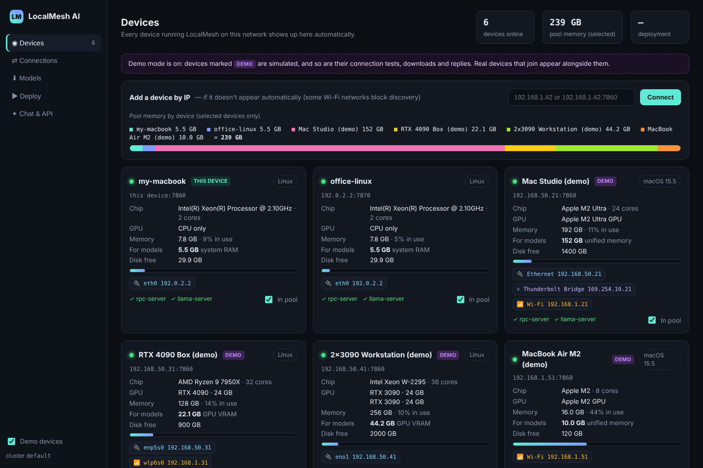
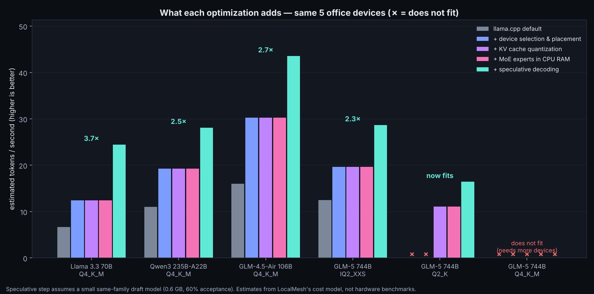
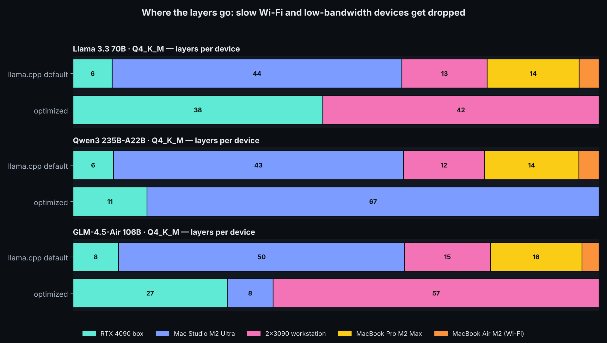
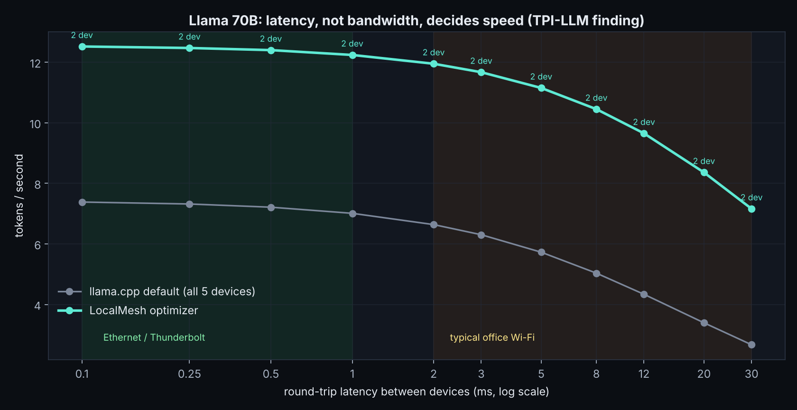
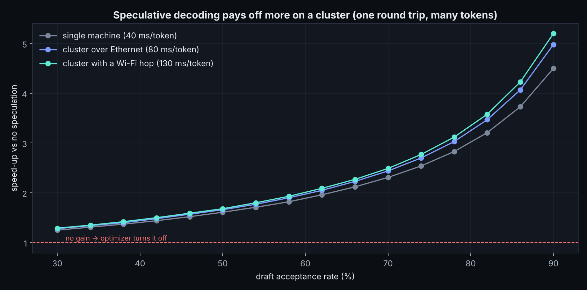
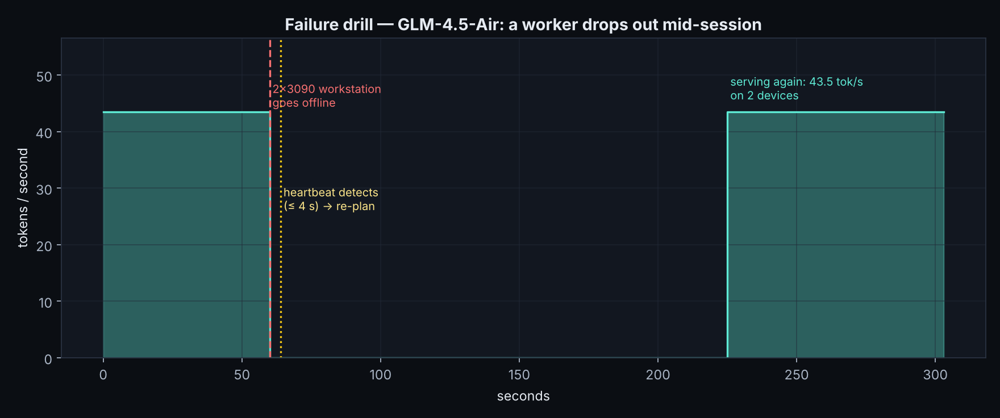
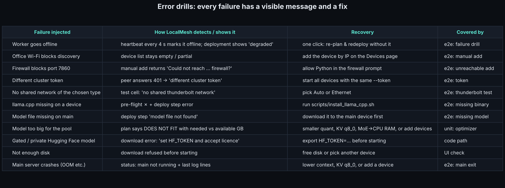

# LocalMesh AI

**Turn the computers in a room into one AI cluster.** MacBooks (M1–M4), Linux boxes with
NVIDIA GPUs, Windows PCs — every device runs the same small app, they find each other on the
network, you test every connection, pick any GGUF model from Hugging Face, and LocalMesh
splits it across the devices with llama.cpp and serves an OpenAI-compatible API.



## What it does

| Page | |
|---|---|
| **Devices** | Auto-discovers devices (UDP broadcast) or add by IP. Shows chip, GPU, memory usable for models, disk, Wi-Fi / Ethernet / Thunderbolt interfaces, llama.cpp status. Tick which devices are in the pool. |
| **Connections** | Tests latency, jitter, loss and throughput between **every pair** of devices, on the network you choose (Auto / Ethernet / Wi-Fi / Thunderbolt). Colour-coded matrix. |
| **Models** | Search Hugging Face for GGUF models; all versions (Q2…Q8, split files grouped) with a fit check. **Optimizer** compares llama.cpp's default split with the optimized plan, and downloads to the device you pick (resumable). |
| **Deploy** | Pre-flight checks, then starts `rpc-server` on workers and `llama-server` on the main device with the optimized layer split (`--device` + `--tensor-split`), KV cache type, MoE offload and optional speculative decoding. Live logs; **degraded** warning + one-click re-plan if a device drops. |
| **Chat & API** | Streaming chat with tokens/s, and the `http://<main>:8080/v1` endpoint for any OpenAI-compatible app. |

## Quick start (each device)

```bash
# macOS / Linux
./start.sh                 # first run creates .venv and installs 4 small packages
./scripts/install_llama_cpp.sh   # once per device: builds rpc-server + llama-server
```
```bat
:: Windows
start.bat
:: llama.cpp: download a release zip from github.com/ggml-org/llama.cpp/releases that
:: contains rpc-server.exe and llama-server.exe, unzip it, and set LLAMA_CPP_DIR to that folder
```

Open **http://localhost:7860** on any device. Requires Python 3.9+.

Useful options: `--demo` (adds 4 clearly-labelled simulated devices for presentations),
`--token SECRET` (devices need the same secret to join), `--cluster NAME` (separate groups),
`--name "Bibek's MacBook"`, `--models-dir PATH`. Gated models: `export HF_TOKEN=hf_…`.
Hugging Face mirror: `export HF_ENDPOINT=https://hf-mirror.com`.

## Office demo checklist (≈ 10 minutes)

1. **Copy this folder** to each colleague's machine (USB / AirDrop / `git`), run `./start.sh --token <pick-one>`.
   macOS asks *"Allow incoming connections for Python?"* → **Allow**.
2. Open the dashboard on your laptop. Devices appear within a few seconds.
   Not appearing? Office Wi-Fi often blocks discovery → **Add a device by IP** (the IP is printed in each device's terminal).
3. **Connections → Test every connection.** Plug in Ethernet if you can — the matrix shows why (Wi-Fi ≈ 3–10 ms, Ethernet < 1 ms).
4. **Models → "Qwen2.5-0.5B-Instruct" → Q4_K_M → Plan → Download** (≈ 400 MB) to your laptop for a quick live run.
5. Run `./scripts/install_llama_cpp.sh` on devices showing ✗ rpc-server (≈ 5 min each, needs `cmake`; on macOS `brew install cmake`).
6. **Deploy → main = your laptop, tick workers → Deploy**, then **Chat**.
7. To show the big picture without big hardware: start with `--demo`, search **GLM-5**, click **Plan** on IQ2_XXS — the optimizer shows it fits only via KV-cache quantization / MoE offload, and which devices it leaves out and why.

Ports: TCP 7860 (app), UDP 7861 (discovery), TCP 50052 (rpc-server), TCP 8080 (API).

## Optimizations from recent research

See **[docs/RESEARCH.md](docs/RESEARCH.md)** for the 10 papers and exactly what was implemented.
In short: heterogeneity-aware layer placement with **device selection** (prima.cpp/Halda,
EdgeShard, Helix), **latency-driven** link decisions (TPI-LLM), **KV cache quantization**
(KIVI), **MoE experts in CPU RAM** (KTransformers, OSDI'26), **speculative decoding** with
acceptance-aware draft length (EAGLE-3, "performance or illusion?"), and **re-planning when a
device drops** (Kafetzis et al.).

### Simulation (`python tools/simulate.py`)

Same 5 office devices (RTX 4090 box, Mac Studio M2 Ultra, 2×3090 workstation, MacBook Pro M2
Max, MacBook Air on Wi-Fi). Estimates from the cost model, not hardware benchmarks:

| Model | llama.cpp default | LocalMesh | |
|---|---|---|---|
| Llama 3.3 70B Q4_K_M | 6.7 tok/s | 12.4 (24.5 with draft model) | 1.9× / 3.7× |
| Qwen3 235B-A22B Q4_K_M | 11.1 | 19.3 (28.1) | 1.7× / 2.5× |
| GLM-4.5-Air Q4_K_M | 16.0 | 30.2 (43.5) | 1.9× / 2.7× |
| GLM-5 744B IQ2_XXS | 12.5 | 19.6 (28.7) | 1.6× / 2.3× |
| GLM-5 744B Q2_K (262 GB) | does not fit | 11.1 (16.4) | now fits |
| GLM-5 744B Q4_K_M (438 GB) | does not fit | does not fit | needs ~2 more big machines |








## Tests

```bash
python tests/test_optimizer.py   # 7 unit tests for the planner
python tests/e2e_test.py         # 30 end-to-end checks: 3 real nodes + fake Hugging Face + fake llama.cpp
```
The end-to-end test covers discovery, the connection matrix, HF search and split-file
download, optimizer-driven deploy with pinned layer split, streaming chat through workers,
killing a worker mid-session → degraded → one-click re-plan → serving again, crash and
missing-binary errors, and token protection.

## Honest limits

* **Speed over Wi-Fi is poor** for any distributed LLM — use Ethernet / Thunderbolt for real work.
* Splitting a model across devices *pools memory*; it does not make a small model faster than one good GPU.
* GLM-5 at 4-bit needs ~440 GB of fast memory — plan for that many GB across the pool.
* llama.cpp's RPC protocol has **no encryption or authentication**: only run workers on a trusted LAN.
  LocalMesh binds rpc-server to the chosen LAN IP only, and `--token` protects LocalMesh's own API.
* Speed numbers in the UI are estimates; the Chat page shows the real tokens/s.

## Project layout

```
localmesh/        server.py (node + controller API) · optimizer.py · hardware.py · discovery.py
                  hf.py (Hugging Face) · procs.py (llama.cpp processes) · demo.py · static/index.html
scripts/          install_llama_cpp.sh
tools/            simulate.py → docs/sim/*.png
tests/            e2e_test.py · test_optimizer.py · fakes/ (fake HF + fake llama.cpp for tests)
```
